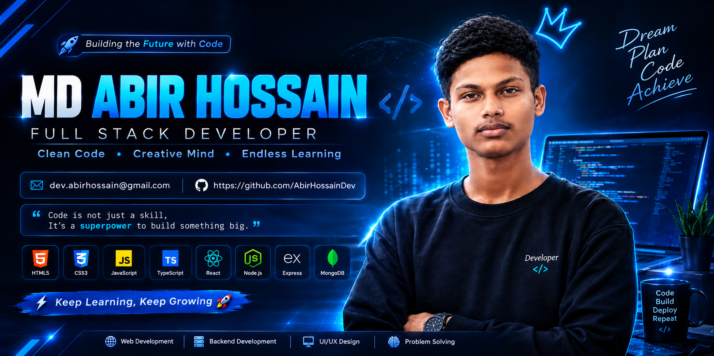
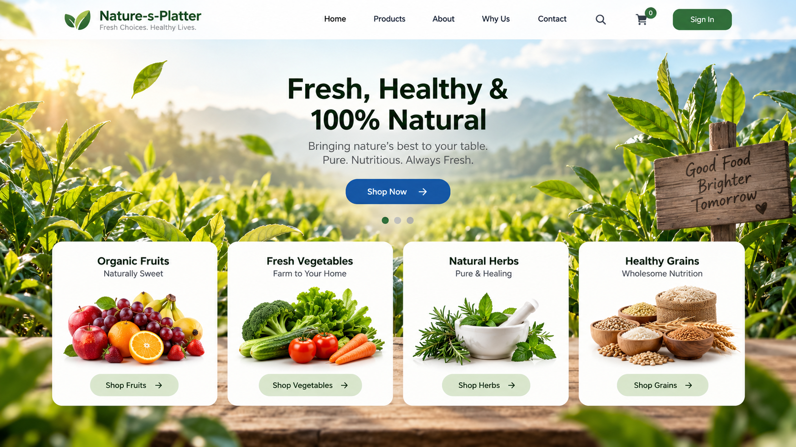

<!-- 🌈 PREMIUM ANIMATED HEADER -->

 

<!-- 💓 DYNAMIC WELCOME TYPING -->

  

<!-- ⚡ TECH BADGES LINE -->

  
  
  
  
  
  
  

 

<!-- 🌈 COLORFUL GRADIENT LINE -->

 

<!-- 🖼️ HERO DEVELOPER BANNER -->

 

<!-- 🔗 QUICK SOCIAL LINKS -->

  
  
  
  

---

# 👨‍💻 About Me[span_1](start_span)[span_1](end_span)

<table>
<tr>

<td width="55%" valign="top">

### 👋 Hi there, I'm MD. Abir Hossain

I'm a passionate full-stack developer who enjoys building modern, high-performance web applications[span_2](start_span)[span_2](end_span).

I love working with JavaScript, **React**, and **Node.js**, and I'm always exploring new tools and technologies to improve my workflow[span_3](start_span)[span_3](end_span).

Currently, I'm focused on expanding my knowledge in GraphQL and Docker while working on exciting real-world projects[span_4](start_span)[span_4](end_span).

### 🚀 What I Love[span_5](start_span)[span_5](end_span)

- 💻 **Web Development**[span_6](start_span)[span_6](end_span)
- ⚛️ **React Development**[span_7](start_span)[span_7](end_span)
- 🟢 **Node.js Ecosystem**[span_8](start_span)[span_8](end_span)
- 🧠 **Problem Solving & Algorithms**[span_9](start_span)[span_9](end_span)
- 🔧 **Building Real-World Projects**[span_10](start_span)[span_10](end_span)
- 📚 **Continuous Learning**[span_11](start_span)[span_11](end_span)

</td>

<td width="45%" align="center">

  

<!-- EXACT IMAGE REFERENCE MAINTAINED AS REQUESTED -->

</td>

</tr>
</table>

---

# ⚡ Supercharge Tech Stack

### 🎨 Frontend Mastery

 

### ⚙️ Backend & Database

 

### 🛠️ DevOps, Tools & Environment

---

# 📊 GitHub Analytics & Metrics

<table>
<tr>

<td width="50%" align="center">
  
</td>

<td width="50%" align="center">
  
</td>

</tr>
</table>

---

# 🔥 GitHub Streak & Activity

  

---

# 🧊 3D Contribution Universe

### 🌈 Night Rainbow 3D Matrix

  

### 🐍 Contribution Snake

---

# 🚀 Featured Spotlight Project

<table>
<tr>

<td width="50%" align="center">
  <h2>🌿 Nature-s-Platter</h2>
  
</td>

<td width="50%" valign="middle">
  <h3>🍃 Fresh & Organic E-Commerce Platform</h3>
  
A modern, full-stack responsive web application focused on fresh, healthy, and natural organic products.

  
  <h3>🛠️ Core Tech Stack</h3>
  

    
  
</td>

</tr>
</table>

---

# 🎯 2026 Engineering Roadmap

| 🎯 Milestone | 🚀 Status | 🛠️ Tech / Tool |
|:---:|:---:|:---:|
| **Master Advanced TypeScript** | 🔥 In Progress | Generics, Utility Types |
| **Architect with Next.js App Router** | 🚀 Active | SSR, ISR, Server Actions |
| **Scale APIs with GraphQL** | 📚 Learning | Apollo Server, Schema Stitching |
| **Containerize with Docker & K8s** | 💪 Practicing | Docker Compose, Volumes |
| **Open Source Contributions** | 🌟 Upcoming | React Ecosystem |

---

## 💡 Code Philosophy

> *“Code is like humor. When you have to explain it, it's bad.”* — **Cory House**

 

  

<!-- 🌈 DYNAMIC FOOTER BANNER -->

 

<!-- 👋 THANK YOU TYPING -->

 

  <b>🌱 Learn • Build • Optimize • Repeat 🔥</b>

 

<!-- 🔗 FOOTER SOCIAL BUTTONS -->

  

  <b>Built with ❤️ and dedication by MD. Abir Hossain</b>

